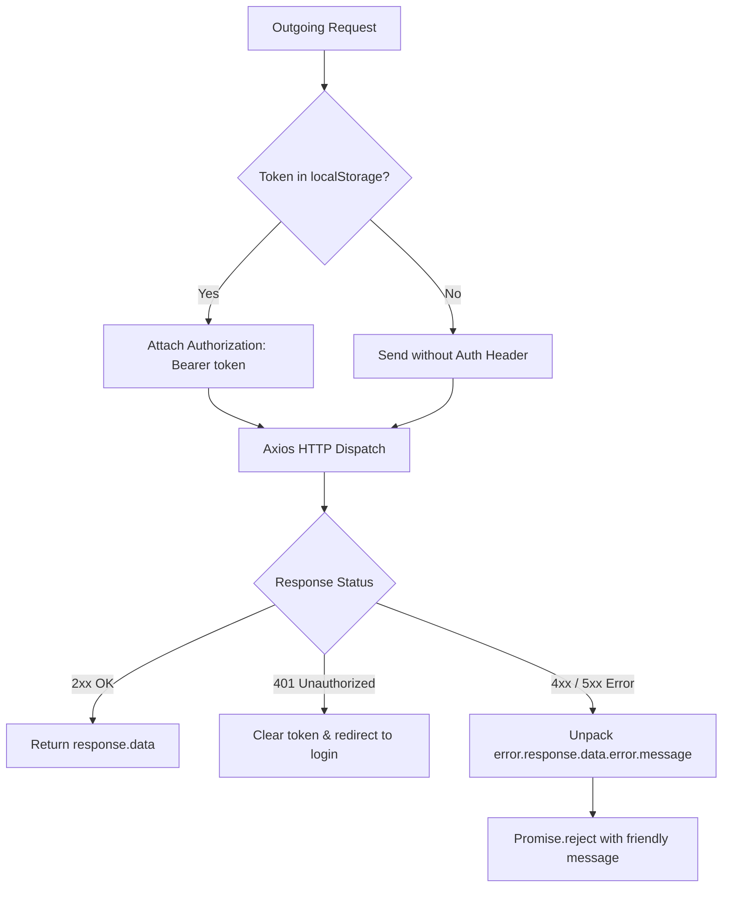

# Client API Implementation Details

## 1. Request & Response Interceptors (`http.js`)



## 2. Invariants & Guarantees
- Unpacks `response.data` directly, simplifying TanStack React Query fetcher functions:
  ```javascript
  const { data } = useQuery({ queryKey: ['books'], queryFn: () => booksApi.list() });
  ```
- Ensures that when backend triggers raise business violations (e.g. `LOAN_LIMIT_REACHED` or `NO_COPIES_AVAILABLE`), the normalized error message string reaches React components cleanly for toast notifications.

