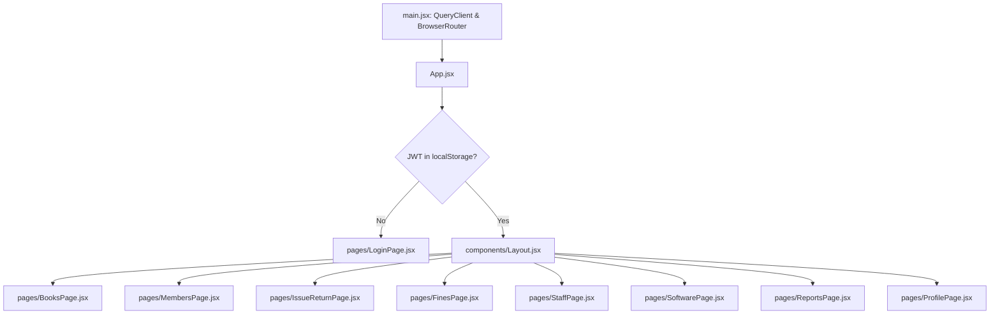

# Client Source Implementation Details

## 1. Application Layout & Route Architecture

## 2. Authentication Lifecycle
- **Token Persistence:** Stored securely in `localStorage` under key `'token'`.
- **Automatic Attachment:** Injected as HTTP Bearer token on all outgoing requests by `src/api/http.js`.
- **401 Interception:** If an expired or invalid token response is returned from Express, the Axios interceptor immediately clears `localStorage` and redirects the user to `/login`.
- **Staff access:** Public registration creates Librarian accounts only. The profile screen loads and updates the signed-in staff member's own information; changing a password requires the existing password.
