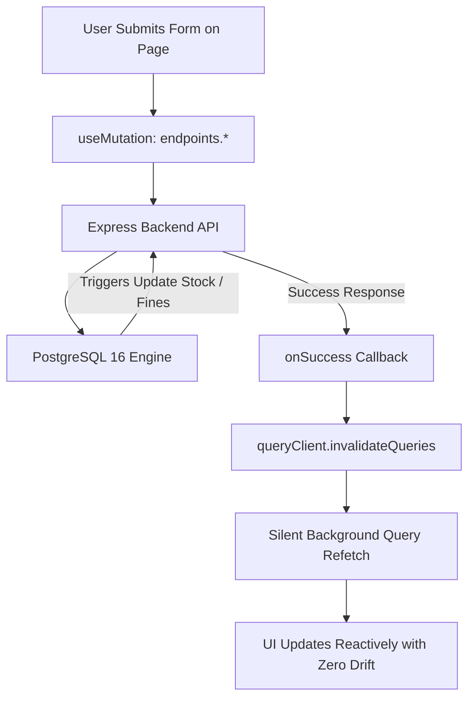

# Client Pages Implementation Details

## 1. Page Caching & Invalidation Architecture

Every management page integrates with **TanStack React Query** to manage asynchronous server state:

## 2. Invariants & User Experience Standards
- **Account lifecycle:** `LoginPage.jsx` provides sign-in and public librarian signup; `ProfilePage.jsx` displays the current staff profile and supports editing permitted fields and changing passwords.
- **Responsive shell:** `Layout.jsx` provides desktop navigation, a mobile drawer, active page context, profile access, and sign-out.
- **Immediate Feedback:** Form actions disable submission buttons during `isPending` states to prevent double-clicks.
- **Friendly Toast Translations:** When a database trigger aborts an invalid loan (`P0001: LOAN_LIMIT_REACHED` or `NO_COPIES_AVAILABLE`), the API interceptor unpacks the message and displays a clear human-readable explanation instead of an obscure database stack.
- **Direct Procedural Execution:** The Fines page provides one-click manual execution of `sp_calculate_fines(asOfDate, 2)`, letting staff reconcile fines on demand.
