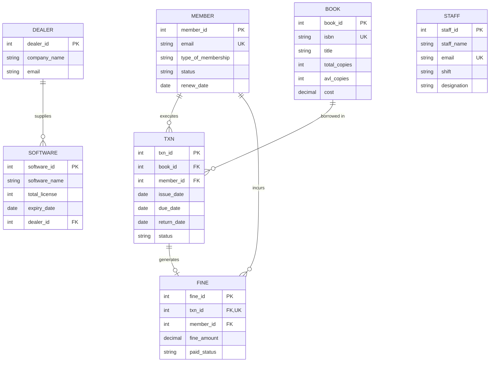
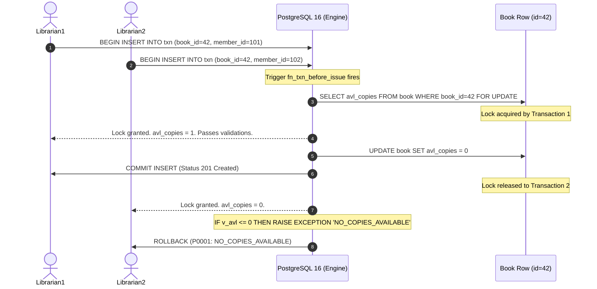

# Root Architectural Implementation Blueprint

## 1. System Design Philosophy

The architecture of this Library Management System adheres to the **Database as Primary Defense** paradigm. Rather than relying solely on transient application-level checks that can be circumvented during network race conditions, concurrency anomalies, or external script execution, business invariants are locked in PostgreSQL 16:

1. **Strict Data Invariants:** Check constraints prevent negative inventory, illegal status transitions, and illogical date relationships ($renew\_date < join\_date$).
2. **Deterministic Trigger Hooks:** Concurrency locks (`SELECT ... FOR UPDATE`) are held in `BEFORE INSERT ON txn` so two simultaneous issue requests for the final copy serialize safely.
3. **Procedural Heavy Lifting:** Daily fine calculations and reporting leverage PL/pgSQL cursors (`sp_calculate_fines`, `sp_generate_defaulter_report`), keeping application Node.js memory constant ($O(1)$) regardless of whether the library tracks $1,000$ or $1,000,000$ transactions.
4. **Thin Controller / Rich Service / Robust ORM Pattern:** Express controllers do zero business calculation; services orchestrate transactions and map database error codes (such as `P0001` with error message tokens) into deterministic HTTP response contracts.

---

## 2. Relational Schema & Entity Relationships

---

## 3. Concurrency & Race Condition Control

When issuing a book with $avl\_copies = 1$ to two concurrent users:

---

## 4. Database Exception Mapping Protocol

Custom errors raised by PL/pgSQL using error code `P0001` are intercepted by the backend exception translation layer (`server/src/utils/dbErrors.js`) and converted to standard HTTP statuses:

| Database Exception Code / Token | HTTP Status | Client Response Message |
| :--- | :--- | :--- |
| `BOOK_NOT_FOUND` | 404 Not Found | "The requested book ID does not exist." |
| `MEMBER_NOT_FOUND` | 404 Not Found | "The requested member ID was not found." |
| `NO_COPIES_AVAILABLE` | 409 Conflict | "No available copies of this book remain on the shelf." |
| `MEMBER_NOT_ACTIVE` | 422 Unprocessable | "Member account is not active (Suspended or Inactive)." |
| `MEMBERSHIP_EXPIRED` | 422 Unprocessable | "Membership expired prior to the requested issue date." |
| `LOAN_LIMIT_REACHED` | 422 Unprocessable | "Member has reached active borrowing quota for their tier." |
| `UNPAID_FINES_EXCEED_LIMIT` | 422 Unprocessable | "Member has outstanding unpaid fines exceeding Rs. 100." |
| `ALREADY_RETURNED` | 409 Conflict | "Transaction has already been returned previously." |
| `RETURN_BEFORE_ISSUE` | 422 Unprocessable | "Return date cannot be earlier than issue date." |
| `TOTAL_BELOW_ON_LOAN` | 409 Conflict | "Cannot decrease total copies below currently issued copies." |
| `FINE_NOT_PAYABLE` | 409 Conflict | "Fine is already paid or waived, or does not exist." |

---

## 5. Directory Map of Implementations

- **Infrastructure & Pipeline:** `/.github/workflows/` (Ubuntu CI runner with PostgreSQL 16 service container)
- **Database Migrations & Triggers:** `/server/prisma/migrations/` (DDL, Check constraints, Triggers, Functions, Procedures)
- **Execution Scripts:** `/server/scripts/` (Automated TDD gate runner, test database resetter, nightly fine recalculation)
- **Application Core:** `/server/src/` (Zod schemas, Express routing, thin controllers, transactional business services, date utilities)
- **Automated Test Matrix:** `/server/tests/` (Algorithmic unit tests, direct DB trigger integration tests, HTTP Supertest suites)
- **Client Frontend:** `/client/src/` (TanStack React Query hooks, Axios HTTP interceptors, reusable UI components, administration screens)

