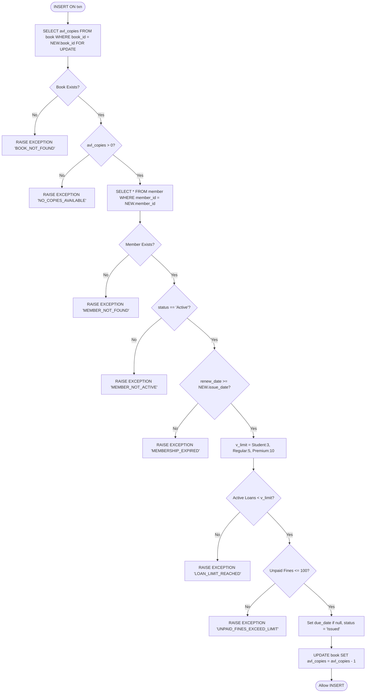

# Triggers Implementation Details

## 1. Procedural Algorithms & Flow

### 1.1 Trigger 1: `trg_txn_before_issue` (`fn_txn_before_issue`)

### 1.2 Trigger 2A & 2B: Return Validation & Stock Replenishment
- **`fn_txn_before_return` (BEFORE UPDATE OF return_date):**
  1. Checks if `OLD.return_date IS NOT NULL` and changed $\implies$ raises `'ALREADY_RETURNED'`.
  2. If `NEW.return_date < NEW.issue_date` $\implies$ raises `'RETURN_BEFORE_ISSUE'`.
  3. Mutates `NEW.status := 'Returned'`.
- **`fn_txn_after_return` (AFTER UPDATE OF return_date):**
  1. Executes `UPDATE book SET avl_copies = LEAST(avl_copies + 1, total_copies) WHERE book_id = NEW.book_id;`.
  2. Guarantees that `avl_copies` never exceeds `total_copies` under any operational anomaly.

### 1.3 Trigger 3: `trg_book_guard` (`fn_book_guard`)
- **Inventory Invariant:** The library cannot reduce `total_copies` below the count currently on loan:
  $$\text{Copies on Loan} = OLD.total\_copies - OLD.avl\_copies$$
- If $NEW.total\_copies < (\text{Copies on Loan})$, aborts with `'TOTAL_BELOW_ON_LOAN'`.
- Prevents database admins or API clients from creating negative physical availability.

