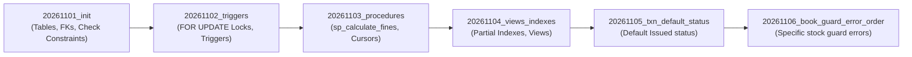

# Database Migrations Implementation Details

## 1. Migration Execution Mechanics

Prisma applies migrations chronologically using the `_prisma_migrations` internal audit table.



## 2. Execution Commands
- **Deploy to Target DB:**
  ```bash
  npx prisma migrate deploy
  ```
- **Local Dev Sync:**
  ```bash
  npx prisma migrate dev
  ```
- **Integrity Validation:**
  Every migration runs inside an implicit PostgreSQL DDL transaction (`BEGIN; ... COMMIT;`), ensuring atomicity. If any constraint or trigger syntax fails, the entire migration aborts and rolls back without dirty schema artifacts.
