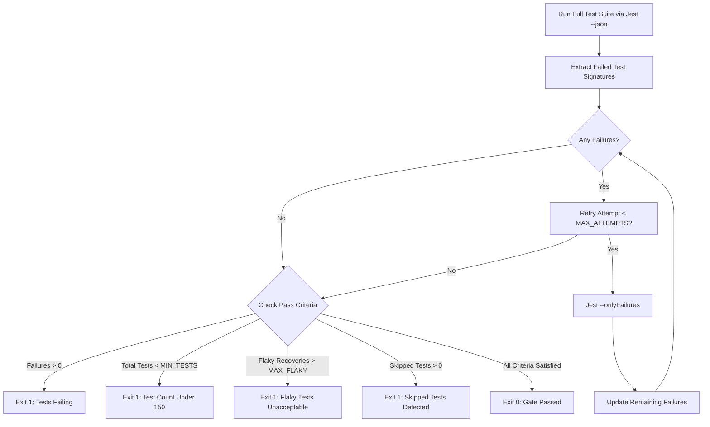

# Server Scripts Implementation Details

## 1. Script Architecture & Workflows

### 1.1 Strict TDD Gate Architecture (`tdd-gate.js`)


- **Flakiness Detection Formulation:**
  $$\text{Flaky} = \text{Failures}_{\text{Attempt 1}} \setminus \text{Failures}_{\text{Attempt } N}$$
  Any test that initially failed but subsequently succeeded is explicitly reported as flaky.

### 1.2 Test Database Reset (`reset-test-db.js`)
1. Parses `TEST_DATABASE_URL` to extract target database name and credentials.
2. Connects to PostgreSQL's default `postgres` database via `pg.Client`.
3. Issues `pg_terminate_backend(pid)` to forcibly close any lingering connection pools.
4. Executes `DROP DATABASE IF EXISTS library_test;` and `CREATE DATABASE library_test;`.
5. Spawns `npx prisma migrate deploy` with `DATABASE_URL=TEST_DATABASE_URL` to ensure identical tables, constraints, triggers, and procedures.

### 1.3 Batch Fine Worker (`run-nightly-fines.js`)
Invokes PostgreSQL procedural routines with parameterized dates:
```javascript
await prisma.$executeRaw`CALL sp_calculate_fines(CAST(${dateStr} AS DATE), CAST(${rate} AS NUMERIC));`;
await prisma.$executeRaw`CALL sp_generate_defaulter_report(CAST(${dateStr} AS DATE));`;
```
Ensures continuous operational consistency across library inventory and circulation records.

