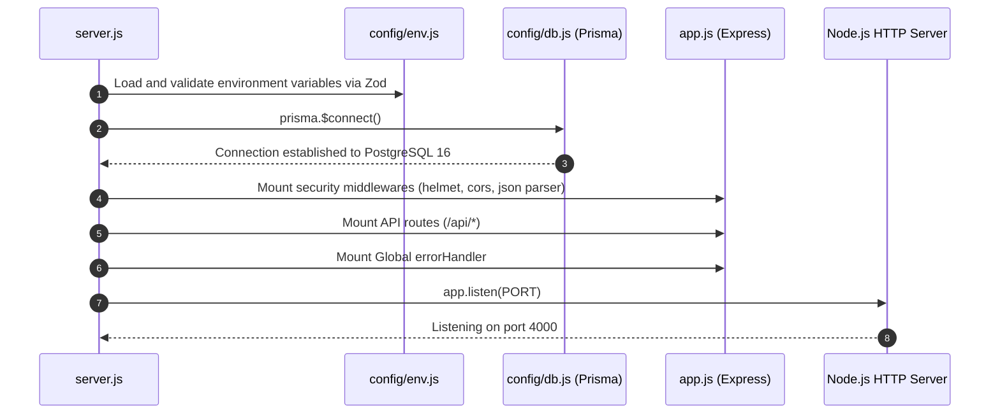

# Server Source Implementation Details

## 1. Application Architecture & Startup Sequence

## 2. Decoupled Architecture (`app.js` vs `server.js`)
- `app.js` exports the raw Express application without calling `app.listen()`. This allows `supertest` in integration tests to bind directly to the Express application object in memory, spinning up ephemeral virtual listeners without occupying network ports or experiencing port collision issues.
- `server.js` acts solely as the runtime bootstrapper, establishing database connections and initiating the TCP listener for production and development environments.

