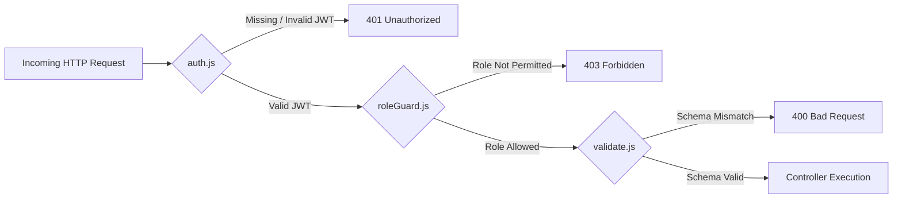

# Middlewares Implementation Details

## 1. Security Architecture & Pipeline



## 2. Invariants & Implementation Standards

### 2.1 Error Handling Pipeline (`errorHandler.js`)
- Standard response format:
  ```json
  {
    "success": false,
    "error": {
      "code": "MEMBERSHIP_EXPIRED",
      "message": "Member renewal date has lapsed",
      "details": null
    }
  }
  ```
- Protects operational confidentiality by suppressing error stack traces in `production` environments while exposing granular debugging details in `development` and `test` environments.
- Normalizes system parse failures (`entity.too.large` $\to$ HTTP 413, `entity.parse.failed` $\to$ HTTP 400).

