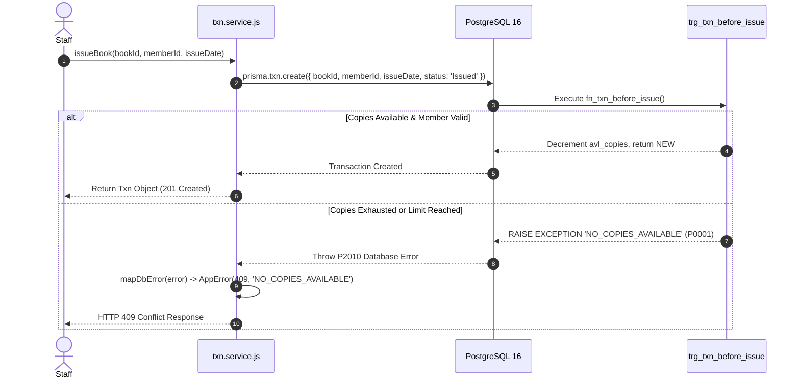

# Services Implementation Details

## 1. Domain Logic & Transaction Specifications

### 1.1 Staff Authentication & Profile (`auth.service.js`)
- Public signup validates staff details, hashes the password with bcrypt, assigns the non-privileged `Librarian` designation, and returns a JWT session. Public payloads cannot choose a designation.
- Login verifies the stored bcrypt hash; no shared or hard-coded password fallback is accepted.
- Profile reads and edits are scoped to the authenticated JWT staff ID. Email and designation are not self-editable. Password changes require the current password and store a new bcrypt hash.

### 1.2 Book Circulation Lifecycle (`txn.service.js`)

### 1.3 Return & Fine Assessment Workflow
When `returnBook(txnId, returnDate)` is invoked:
1. Validates that the transaction exists and has not already been returned (`returnDate === null`).
2. Wraps the return process in an interactive database transaction:
   - Updates `returnDate` on the transaction row, firing `trg_txn_before_return` (status to `'Returned'`) and `trg_txn_after_return` (increments `avl_copies`).
   - If $return\_date > due\_date$, computes late days using leap-year safe UTC date differences.
   - Calculates fine capped at the book's replacement cost:
     $$\text{Fine} = \min\left((\text{days\_late}) \times 2, \text{book.cost}\right)$$
   - Upserts the resulting fine record into `fine` table with status `'Unpaid'`.

### 1.4 External Metadata Ingestion (`googleBooks.service.js`)
- **Fast Lookup:** First checks local in-memory LRU cache (`isbnCache`).
- **Resilient Request:** Sets an `AbortController` timeout of 3000ms against Google Books Volumes API.
- **Graceful Fallback:** If Google Books times out or returns HTTP 429/500, immediately queries the Open Library API without surfacing external errors to client users.
