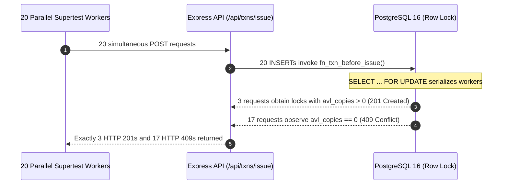

# API Integration Tests Implementation Details

## 1. Concurrency Simulation Flow (`api.test.js`)

Test case 8 dispatches 20 simultaneous HTTP POST requests against a book record with only 3 available copies:
```javascript
const promises = members.map(m =>
  request(app)
    .post('/api/txns/issue')
    .set('Authorization', `Bearer ${librarianToken}`)
    .send({ bookId: book.bookId, memberId: m.memberId, issueDate: '2024-05-01' })
);
const responses = await Promise.all(promises);
```



- **Stock Verification:** Asserts that after all 20 promises resolve, `book.avl_copies` equals exactly 0, proving zero inventory leaks or negative stock counts under high-concurrency loads.

